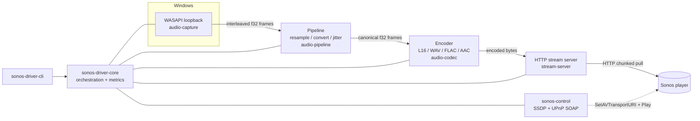

# Architecture

`sonos-driver` is a **pure-Rust, user-mode Windows → Sonos audio bridge**. It
captures the system audio render endpoint with WASAPI loopback, runs it through a
small DSP pipeline, encodes it with a selectable codec, and serves it over a local
HTTP endpoint that Sonos players pull from after being pointed at it over UPnP.

> **Latency reality:** Sonos enforces a non-configurable network playback buffer
> (~300–800 ms). True sub-100 ms is impossible in software. See
> [LATENCY-BUDGET.md](./LATENCY-BUDGET.md). The design minimises every millisecond
> we control and is honest about the floor we cannot.

## Workspace layout

The project is a Cargo workspace of small, single-responsibility crates that all
build against the stable trait contracts in `audio-core`. This lets the Phase-1
workstreams proceed in parallel without stepping on each other.

| Crate | Responsibility | Workstream |
|-------|----------------|------------|
| `audio-core` | Shared types & trait contracts: `AudioFrame`, `AudioFormat`, `Encoder`, `Transport`, `AudioSource`, `Config`, error model. Plus a `SyntheticSource` for hardware-free tests. | Phase 0 |
| `audio-capture` | WASAPI loopback capture of the system render endpoint as an `AudioSource`. | WS-A |
| `audio-pipeline` | Resampling, channel/format conversion, jitter/ring buffering. | WS-E |
| `audio-codec` | `Encoder` implementations: L16 PCM, WAV & FLAC (done); AAC/MP3 unsupported (see [ADR-0004](adr/0004-aac-mp3-codec-evaluation.md)). | WS-D |
| `stream-server` | Local chunked HTTP server that Sonos pulls the stream from. | WS-C |
| `sonos-control` | SSDP discovery + UPnP AVTransport/RenderingControl SOAP control. | WS-B |
| `sonos-driver-core` | Orchestration: wires capture → pipeline → codec → server while driving the Sonos target; session lifecycle, metrics, latency budget. | WS-F |
| `sonos-driver-cli` | `clap` command-line surface: `list`, `stream`, `profiles`. | WS-G |

## Data flow

1. `audio-capture` pulls blocks from the WASAPI loopback client on a dedicated,
   time-critical thread and yields them as `AudioFrame`s.
2. `audio-pipeline` resamples to the Sonos target rate, fixes channel/format, and
   applies a small, configurable jitter buffer (the main latency knob we control).
3. `audio-codec` encodes each frame per the active `CodecProfile`.
4. `stream-server` exposes the encoded bytes on a chunked HTTP endpoint.
5. `sonos-control` tells the target room (group coordinator) to fetch that URL via
   `SetAVTransportURI` and `Play`.
6. Sonos connects back and pulls the stream; its fixed internal buffer dominates the
   end-to-end latency.

## Canonical internal format

Everything between capture and the encoder speaks **interleaved `f32`** (`[L, R, L, R, …]`).
This single representation keeps the pipeline and codec contracts simple and lossless
until the final 16-bit (or compressed) encode step.

## Key trait contracts (`audio-core`)

- **`AudioSource`** — pull-based source of `AudioFrame`s (`read() -> Result<Option<AudioFrame>>`).
  Implemented by `audio-capture` (real) and `SyntheticSource` (tests).
- **`Encoder`** — `encode(&AudioFrame, &mut Vec<u8>)`, optional streaming `prelude()`
  (e.g. the WAV header), `content_type()` for the HTTP `Content-Type`.
- **`Transport` / `StreamSink`** — abstract the act of publishing encoded bytes to a
  player so the server implementation can evolve independently.

Because the workstreams target these traits rather than each other, a synthetic
source + in-memory sink make most of the system testable without hardware or a
real Sonos on the network.

## Threading & runtime model

- **Capture thread:** a dedicated OS thread runs the WASAPI event loop and pushes
  frames into a bounded channel. Bounded back-pressure surfaces as underrun/overrun
  metrics rather than unbounded memory growth.
- **Server runtime:** the HTTP server runs on an async runtime and fans the encoded
  stream out to one or more connected players (a grouped room is addressed by its
  coordinator).
- **Control:** SSDP/UPnP calls are issued from the orchestration layer and are not on
  the audio hot path.

## Configuration

`audio-core::Config` (capture / pipeline / stream / sonos sections) is
`serde`-serialisable and round-trips through TOML, so settings can come from a file
or be overridden on the CLI.

## Quality gates

`rustfmt`, `clippy` (pedantic, `-D warnings`), per-crate unit tests, `cargo-deny`
(licenses + advisories), `cargo-audit` (zero known vulnerabilities), and CodeQL run
in CI on every change. See [the CI workflow](../.github/workflows/ci.yml).
