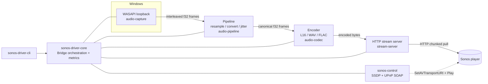
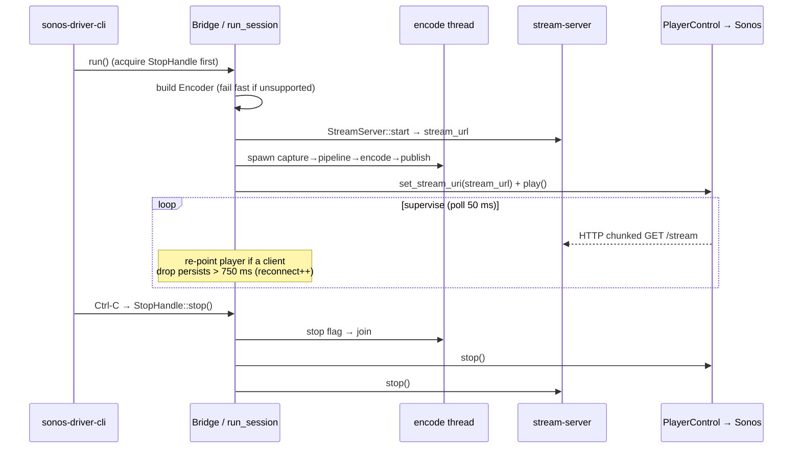

# Architecture

`sonos-driver` is a **pure-Rust, user-mode Windows → Sonos audio bridge**. It
captures the system audio render endpoint with WASAPI loopback, runs it through a
small DSP pipeline, encodes it with a selectable codec, and serves it over a local
HTTP endpoint that Sonos players pull from after being pointed at it over UPnP.

> **Latency reality:** Sonos enforces a non-configurable network playback buffer
> (~300–800 ms). True sub-100 ms is impossible in software. See
> [LATENCY-BUDGET.md](./LATENCY-BUDGET.md). The design minimises every millisecond
> we control and is honest about the floor we cannot.

## Workspace layout

The project is a Cargo workspace of small, single-responsibility crates that all
build against the stable trait contracts in `audio-core`. Targeting those contracts
(rather than each other) keeps the crates decoupled and lets most of the system be
tested without hardware or a real Sonos on the network.

| Crate | Responsibility |
|-------|----------------|
| `audio-core` | Shared types & trait contracts: `AudioFrame`, `AudioFormat`, `Encoder`, `CodecProfile`, `AudioSource`, `StreamSink`/`Transport`, `Config`, and the error model. Bundles a `SyntheticSource` for hardware-free tests. `#![forbid(unsafe_code)]`. |
| `audio-capture` | Event-driven WASAPI loopback capture of the system render endpoint as an `AudioSource`, with a silence keep-alive and device/format-change recovery. The **single** crate permitted `unsafe`, confined to its private `wasapi` COM/FFI module. |
| `audio-pipeline` | Resampling (`rubato`), channel up-/down-mix to stereo, and a bounded jitter/ring buffer with overrun telemetry. `#![forbid(unsafe_code)]`. |
| `audio-codec` | `Encoder` implementations: L16 PCM, WAV, and FLAC (pure-Rust `flacenc`). AAC/MP3 are **not** implemented — no licence-clean pure-Rust encoder exists, so `encoder_for` returns `Error::NotImplemented` (see [ADR-0004](adr/0004-aac-mp3-codec-evaluation.md)). Contains no `unsafe` (confirmed by `cargo-geiger`). |
| `stream-server` | Local chunked-HTTP server (`axum`/`hyper` on `tokio`) that Sonos pulls the stream from, fanning encoded bytes out to every connected player through a bounded broadcast ring buffer. `#![forbid(unsafe_code)]`. |
| `sonos-control` | SSDP discovery + UPnP `AVTransport`/`RenderingControl` SOAP control and zone-group topology resolution, over a tiny hand-rolled HTTP client (`std::net` + `socket2` + `quick-xml`). No TLS. `#![forbid(unsafe_code)]`. |
| `sonos-driver-core` | Orchestration: `Bridge` wires capture → pipeline → codec → server while driving the Sonos target; owns the session lifecycle, metrics, and the controllable-latency snapshot. Exposes the `run_with`/`PlayerControl` dependency-injection seam. `#![forbid(unsafe_code)]`. |
| `sonos-driver-cli` | `clap` command-line surface: `list`, `stream`, `stop`, `config`, and `profiles`. Config precedence is `flags > file > defaults`; Ctrl-C triggers a graceful stop. `#![forbid(unsafe_code)]`. |

## Data flow

1. `audio-capture` pulls blocks from the WASAPI loopback client on a dedicated,
   time-critical thread and yields them as `AudioFrame`s of interleaved `f32`.
2. `audio-pipeline` resamples to the target rate (default 44.1 kHz), up-/down-mixes
   to stereo, and applies a small, configurable jitter buffer (the main latency knob
   we control).
3. `audio-codec` encodes each processed frame per the active `CodecProfile`.
4. `stream-server` exposes the encoded bytes on a chunked HTTP endpoint and fans them
   out to every connected player.
5. `sonos-control` tells the target room (group coordinator) to fetch that URL via
   `SetAVTransportURI` + `Play`.
6. Sonos connects back and pulls the stream; its fixed internal buffer dominates the
   end-to-end latency.

## Canonical internal format

Everything between capture and the encoder speaks **interleaved `f32`** (`[L, R, L, R, …]`).
This single representation keeps the pipeline and codec contracts simple and lossless
until the final 16-bit (or FLAC-compressed) encode step. The bridge always publishes
**stereo**: the pipeline up-mixes mono or down-mixes surround to the front pair so the
encoder's negotiated channel count stays fixed for the whole session.

## Key trait contracts (`audio-core`)

- **`AudioSource`** — pull-based source of `AudioFrame`s
  (`read() -> Result<Option<AudioFrame>>`; `None` is end-of-stream). Implemented by
  `audio-capture::LoopbackCapture` (real) and `SyntheticSource` (tests).
- **`Encoder`** — `encode(&AudioFrame, &mut Vec<u8>)`, an optional one-shot
  `prelude()` (e.g. the WAV header), a `finish()` tail flush, and `content_type()`
  for the HTTP `Content-Type`. Encoders append to a caller-owned buffer to avoid
  per-call allocation on the hot path.
- **`Transport` / `StreamSink`** — abstract publishing encoded bytes to players, so
  the server implementation can evolve independently. `StreamServer` implements
  `Transport` and hands out an `Arc<dyn StreamSink>` whose `write` is wait-free with
  respect to clients.

Because the workstreams target these traits rather than each other, a synthetic
source plus an in-process player make most of the system testable without hardware or
a real Sonos on the network.

## Orchestration: `Bridge` and the session lifecycle

`sonos-driver-core::Bridge` owns one streaming session.

- **`Bridge::run`** resolves the real dependencies — it maps `config.sonos`
  (`uuid` wins over `room`) to a `SonosController` via SSDP/topology discovery, opens
  the platform `LoopbackCapture`, then delegates to `run_with`.
- **`Bridge::run_with(source, control)`** is the **dependency-injection seam**. It
  skips discovery and capture and drives the same `run_session` lifecycle with any
  injected `AudioSource` and `PlayerControl`. The hardware-free end-to-end latency
  harness (`crates/sonos-driver-core/tests/e2e_latency.rs`) uses it with a paced
  `SyntheticSource` and an in-process mock player. See
  [ADR-0007](adr/0007-orchestration-testability-seams.md).

`PlayerControl` is the minimal AVTransport surface the loop needs —
`set_stream_uri` / `play` / `stop` — implemented for `SonosController` in production
and by the mock in tests.

`run_session` (in `session.rs`) then:

1. Builds the `Encoder` first, so an unsupported profile fails **before** a socket is
   bound or the player is contacted.
2. Starts the `StreamServer`, which resolves its own LAN-reachable URL.
3. Spawns the **encode worker** on a dedicated `bridge-encode` thread.
4. Points the player at the stream URL and starts playback (`set_stream_uri` + `play`);
   on failure it tears everything down and propagates the error.
5. **Supervises** until a stop is requested or the worker ends, then tears down
   cleanly: stop the loop, join the worker, stop the player, drop it, stop the server.
   The worker's own result is the session's result.

### The encode loop

The loop is **capture-paced**: one `AudioSource::read` yields one block, which is
resampled/converted, drained through the jitter buffer, and encoded before the next
read. When `buffer_ms == 0` the jitter buffer is bypassed for the lowest latency;
otherwise the buffer is drained fully each iteration to stay at the live edge. The
pipeline is built **on the worker thread** (it need not be `Send`), and the worker
communicates with the rest of the bridge only through atomics. Real jitter absorption
lives downstream in the server's broadcast ring buffer and the Sonos device buffer;
the pipeline buffer here bounds bursts and provides overrun telemetry. See
[ADR-0007](adr/0007-orchestration-testability-seams.md).

## Threading & runtime model

- **Capture thread** (`audio-capture`): a dedicated, time-critical OS thread runs the
  WASAPI event loop and pushes frames into a bounded channel; a second thread writes
  silence to keep the engine raising events. If the consumer falls behind, the newest
  block is dropped and an overrun is counted — bounded back-pressure rather than
  unbounded memory growth.
- **Encode thread** (`sonos-driver-core`): the `bridge-encode` worker runs the
  capture-paced encode loop described above.
- **Server runtime** (`stream-server`): a 2-worker `tokio` runtime owned by the
  `StreamServer` handle runs the `axum` accept loop and a telemetry task, fanning the
  encoded stream out to connected players via a `tokio::sync::broadcast` ring buffer.
  A slow client receives a lag signal and drops its **own** oldest chunks; it never
  stalls the producer or other players.
- **Control** (`sonos-control`): SSDP/UPnP SOAP calls are synchronous and issued off
  the audio hot path — at session start, during supervised reconnects, and at
  teardown.

## Telemetry

`Bridge::metrics()` returns a `BridgeMetrics` snapshot — `frames_captured`,
`frames_streamed`, `underruns`, `reconnects` — backed by relaxed atomics updated from
the encode thread and safe to read from any other thread. `Bridge::controllable_latency()`
returns a `ControllableLatency` snapshot (`samples`, `last`, `mean`, `max`) measuring
the per-chunk software path from a source read to the transport publish; it
deliberately **excludes** the fixed Sonos device buffer, which is characterised in
[LATENCY-BUDGET.md](./LATENCY-BUDGET.md) rather than asserted in CI. `Bridge::latency_estimate()`
gives the coarse, Sonos-buffer-inclusive range surfaced by `sonos-driver profiles`.

## Configuration

`audio-core::Config` (the `capture` / `pipeline` / `stream` / `sonos` sections) is
`serde`-serialisable and round-trips through kebab-case TOML, so settings can come
from a file or be overridden on the CLI with strict `flags > file > defaults`
precedence. See [ADR-0008](adr/0008-cli-config-and-signals.md) and the README's
*Configuration files* section.

## Quality gates

`rustfmt`, `clippy` (pedantic, `-D warnings`), per-crate unit tests, the hardware-free
end-to-end latency harness, `cargo-deny` (licences + advisories), and `cargo-audit`
(known vulnerabilities) form the gate; [docs/QUALITY.md](./QUALITY.md) captures a
reproducible snapshot of the numbers, including the `cargo-geiger` `unsafe`-usage
report. See [CONTRIBUTING.md](../CONTRIBUTING.md) for the exact local commands.
